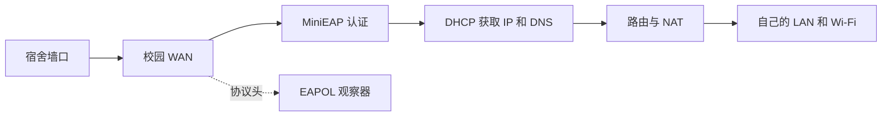

# 认证服务怎样运行

路由器接入校园网分两步：先完成 EAP 认证，再通过 DHCP 取得地址。之后，原厂路由和 NAT 把校园出口提供给自己的 LAN、Wi-Fi 设备。

认证服务只负责校园侧的会话。Wi-Fi 信号、设备发现和下游设备数量，仍由原厂的无线、桥和 DHCP 配置管理。

## 从启动到在线

服务按以下顺序工作：

1. `gate.lua` 检查设备、接口和运行条件。
2. 正常注销旧会话，等待冷却和接口就绪。
3. 启动协议头观察器，再启动一个 MiniEAP 客户端。
4. 看到 Success 后保持客户端运行，继续等待 DHCP 和外网访问结果。

成功后，观察器可以更换日志段，MiniEAP 保持原会话。后续收到服务器的 Identity、MD5 请求，也交给现有客户端处理。

`gate.lua` 等配套部件的整理状态见[服务源码说明](../stock-service/README.md)。

## 为什么只保留一个客户端

两份客户端同时争用同一接口，会让会话和错误来源难以判断。服务因此检查客户端的 PID、启动时钟、父进程和实际程序，确认它是自己启动的进程。更换监督进程时，需要正常交接会话，而不是把旧 PID 写给新进程。

明确认证失败、超时或结果不明时，服务保存故障并停止尝试。对于已经成功过的会话，v2 提供有限链路恢复：同一次开机中任意连续 30 分钟内最多预留两次恢复流程，距上次实际认证启动至少 5 分钟。状态字段和脚本生成方式见[服务说明](../stock-service/README.md)。

## 关机顺序为什么重要

正常关机时，先阻止新认证，停止属于自己的客户端，再趁上游接口仍可用时发送 Logoff。早期实现曾在关机过程中写下旧故障，导致下一次开机被挡住；修正早期关机钩子和处理顺序后，普通重启自动恢复测试通过。

排查这类故障时，需要同时看故障属于哪次启动、是否启动过认证，以及现在的进程归属。它与账号被服务器拒绝是两类问题，处理办法也不同。

## 如何判断真的联网了

分别检查这三件事：

- **认证**：本次会话出现 Success。
- **地址**：校园 WAN 取得有效 IP、网关和 DNS。
- **访问路径**：下游设备通过这台路由器访问网站，而不是借用备用 Wi-Fi 或代理。

记录持续可用性时，还需要明确采样起止时间和间隔。当前实测结果见[现场记录](field-results.md)。

## 局域网与性能放在哪里看

校园 WAN 与自己的 LAN 分开；2.4GHz、5GHz 主 AP 和 LAN 口在私人桥内。投屏、打印和设备发现要用两台下游设备实际测试，EAPOL 观察器负责的是另一侧的校园认证。

速度测试则逐段比较电脑直连、路由器有线下游和 Wi-Fi，同时看忙闲时延迟与 CPU。具体做法见[改善网络体验](network-experience.md)。
